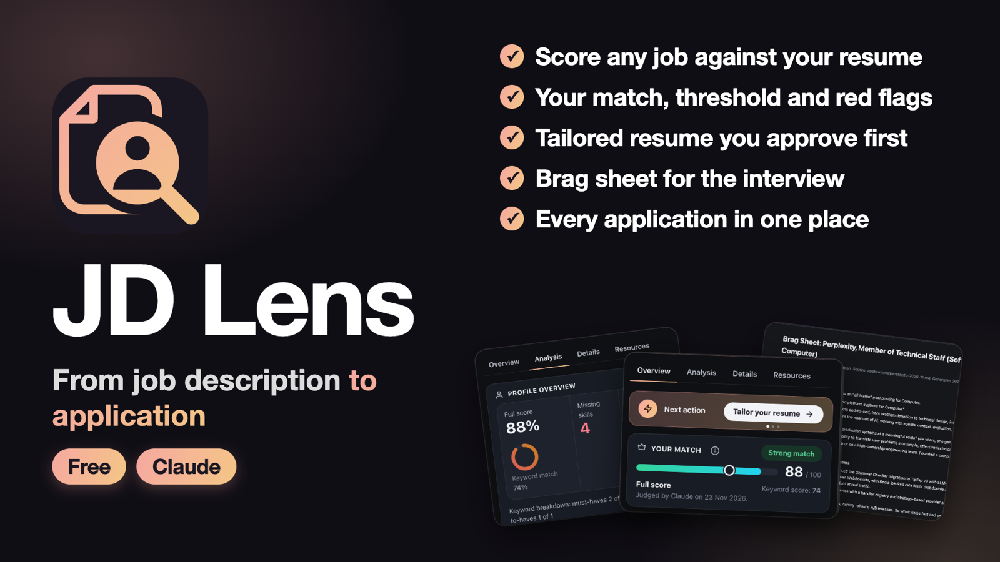

# JD Lens

[Watch the 2 minute demo](https://youtu.be/LMyvg42zjc8)

A Chrome side panel that scores a job description against **your own resume data**, then helps you tailor a resume and prepare for the interview. Everything runs on your computer: no account, no server, no analytics.

- **Instant score** for the page you are on: keyword match, offered salary, red flags (location, a stale posting, scam signals), no AI needed.
- **Your match** against a threshold you choose, with a verdict.
- **Analysis**: matched, missing and unconfirmed skills, each tied to the fact in your resume that backs it.
- **With Claude Code** (optional, your own sign-in): a judged full score, a tailored resume proposal you approve before anything is built, a PDF, and a Brag Sheet to read before the interview.
- **Applications page**: every saved JD with status, rounds and history.

Nothing is applied or sent for you, and resume claims only come from facts in your own master file.

## Get started
Three steps, about 5 minutes. They work on macOS with Chrome, Python 3.9+ and (optionally) Claude Code; [the guide](docs/GETTING-STARTED.md) has the details.

1. **Get the project.** `git clone https://github.com/upadhyayprakash/jd-lens.git`, then open Terminal in that folder.
2. **Run setup once:** `python3 tools/setup.py`. It creates a sample master resume, builds the skill profile, installs the small local helper that lets the extension save files and run Claude, and checks your machine (`python3 tools/doctor.py` repeats the check any time).
3. **Load the extension.** In Chrome open `chrome://extensions`, turn on Developer mode, choose **Load unpacked**, and pick `tools/jd-capture-extension/`. Pin it, open a job posting and click its icon.

It works straight away with the made-up sample resume. To use your own, open **Settings, Your data folder** in the panel and choose the folder that holds your resume data (it can add the sample for you), or edit `master/master-resume.md` in this folder. If a step was skipped, the panel says what is missing and what to do next. The one thing it cannot do for you is step 2: a browser extension may not install the helper itself, so that single command is needed once.

By default your data lives in this folder. To keep it somewhere else (for example your own private repo), choose a data folder in Settings or run `python3 tools/setup.py --data-dir "/full/path"`; see [the guide](docs/GETTING-STARTED.md#keeping-your-data-in-its-own-folder).

## What is in this repo
| Path | What |
|------|------|
| `tools/jd-capture-extension/` | The Chrome extension (side panel, Applications page) |
| `tools/jobd/` | The local helper (native messaging host) that saves files and runs Claude on your machine |
| `tools/jd-scorer/`, `tools/score_*.{py,mjs}` | The scorer |
| `tools/*.py` | Profile builder, application tracking, checks, packaging |
| `.claude/skills/job/` | The `/job` skill for Claude Code |
| `master/master-resume.template.md` | A sample master resume (made-up data) |
| `tailored/_base/layouts/` | Three sample resume layouts (basic, two-column, with photo), with made-up content |
| `docs/` | Getting started, architecture decisions (ADRs), design notes, store listing and release notes |

Your own data (`master/master-resume.md`, `applications/`, `tailored/`, `stories/`, `answers/`, built profile files) is git-ignored: it stays in your clone.

## Tests
`python3 -m unittest discover -s tools/tests` (unit tests, no personal data needed). `python3 tools/tests/render_panel.py [--only=01,02] [--shots]` renders every panel screen in headless Chrome with mock data and checks them.

## Status
Pre-release. Privacy policy and store listing drafts are in `docs/publishing/`.

## Licence
JD Lens is free software under the **GNU Affero General Public License v3.0** (see [LICENSE](LICENSE)). You can use, study, change and share it. If you distribute a modified version, or let others use it over a network, you must make your source available under the same licence. The AGPL covers the code, not the JD Lens name or logo.
